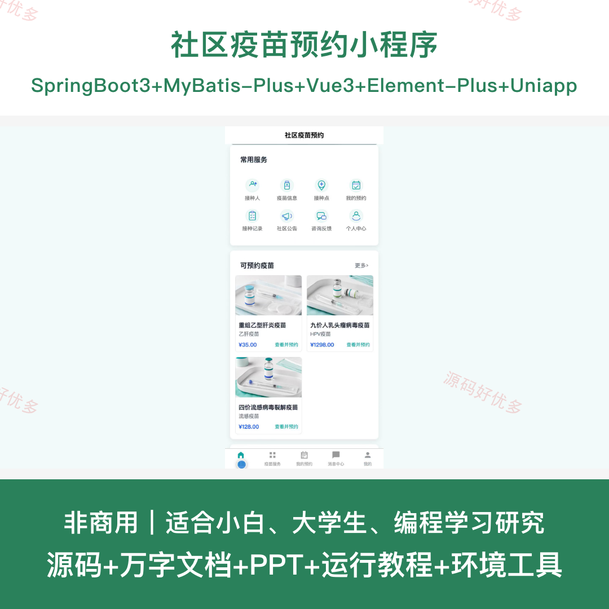
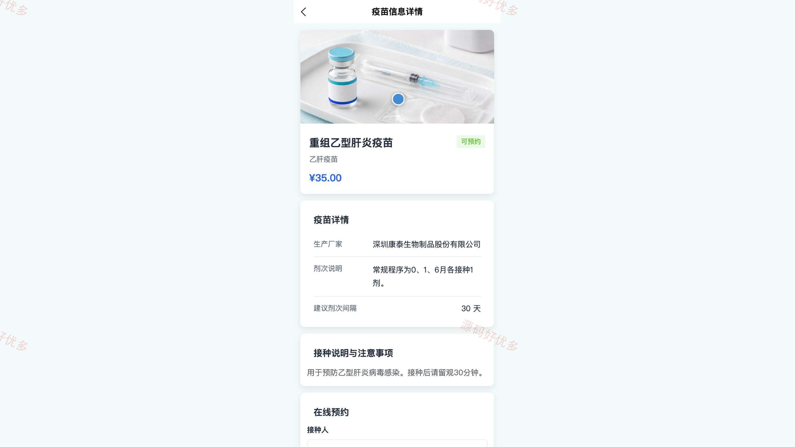
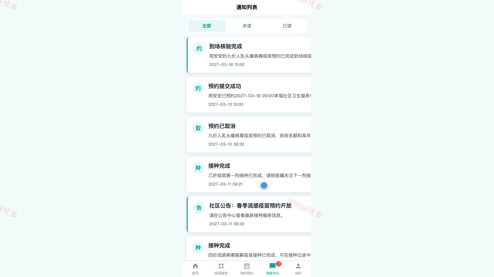
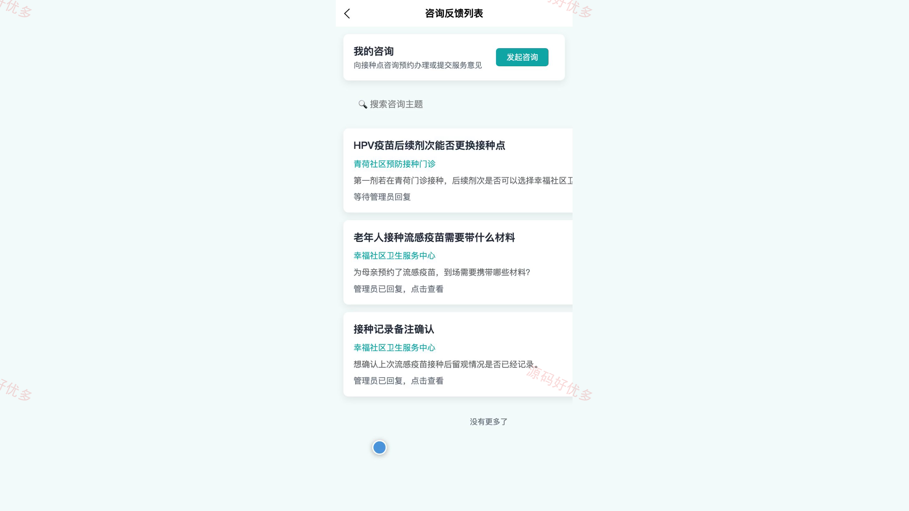
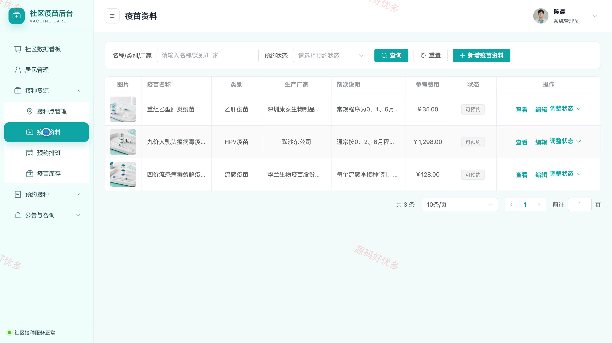
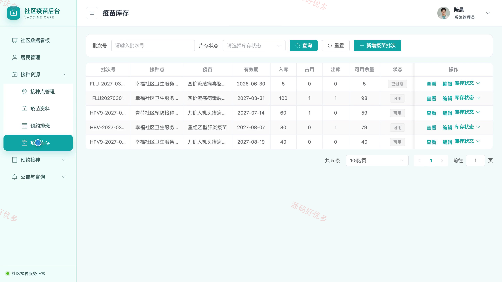
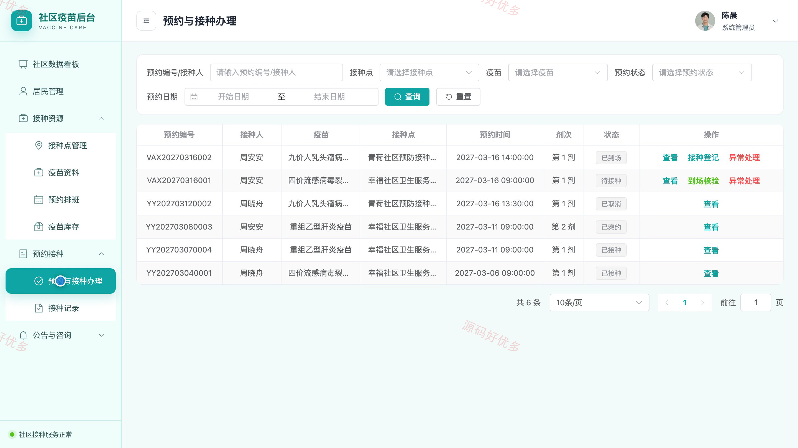

# bs056B
bs056B社区疫苗预约小程序源码 Java SpringBoot3 Vue3 设计文档 PPT
## 源码问题查看主页咨询

### 一、关键词
社区疫苗预约、预防接种服务、疫苗排班预约、接种档案查询、社区卫生服务

### 二、作品包含
源码+数据库+万字设计文档+PPT+全套环境和工具资源+本地部署教程

### 三、项目技术
前端技术： Html、Css、Js、Vue3.4、Element-Plus、uniapp
后端技术：Java、SpringBoot3.2.0、MyBatis-Plus

### 四、运行环境要求
开发工具：IDEA/eclipse + VSCODE + HBuilder X + 微信开发者工具

数据库：MySQL5.7+（共14张表）

数据库管理工具：Navicat10以上版本

环境配置软件： JDK17 + Maven3.6.3

前端Nodejs：20

浏览器：谷歌浏览器

### 五、项目介绍
项目编号：bs056B

社区疫苗预约小程序面向居民和社区接种管理员，围绕疫苗信息、接种人档案、接种点、预约排班、疫苗库存和接种记录形成服务闭环。居民可在小程序查看疫苗与可用排班、提交或取消预约、管理家庭接种人并查询接种记录；管理员通过后台维护接种点、疫苗、排班和库存，办理预约及接种登记，并处理公告和居民咨询。

角色：居民、管理员

居民功能：账号注册登录与个人资料维护、疫苗资料与接种点浏览、家庭接种人档案管理、可用排班选择与接种预约提交、个人预约进度查询与取消、疫苗接种记录查询、社区公告与站内通知查看、接种咨询提交与回复查看。

管理员功能：社区接种数据看板、居民账号与状态管理、接种点与疫苗资料管理、疫苗排班与预约名额管理、疫苗批次库存与状态管理、居民预约办理与接种登记、接种记录查询与备注维护、社区公告发布与居民咨询回复。

### 六、运行截图

